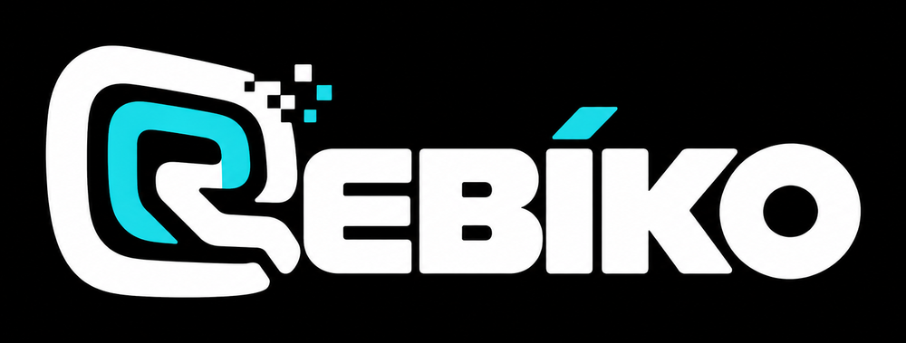
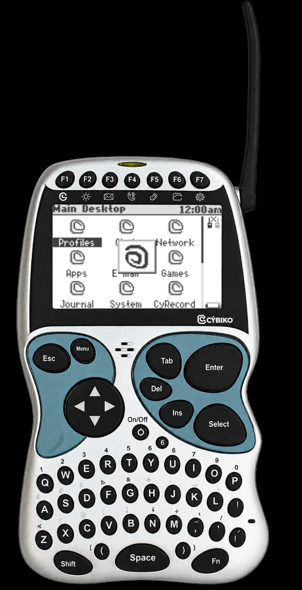
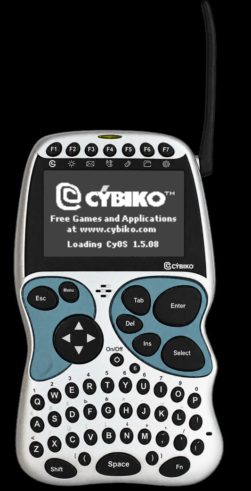
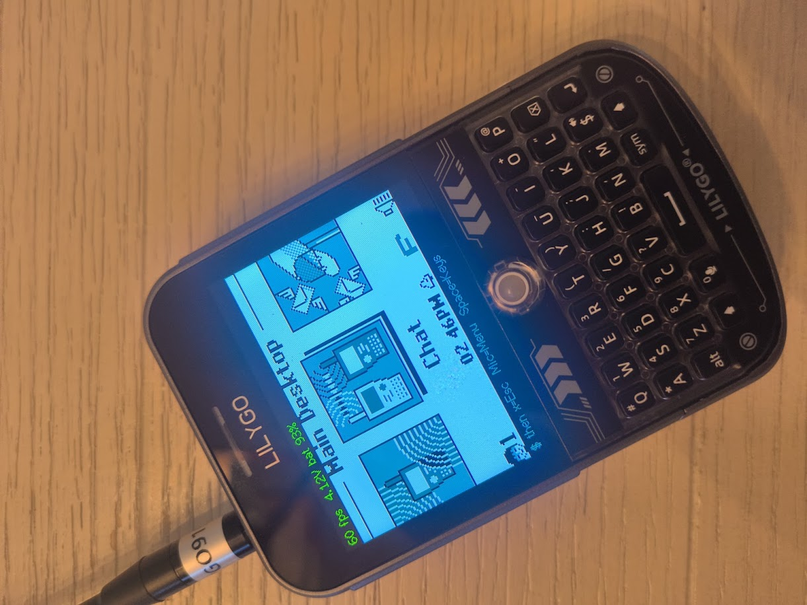
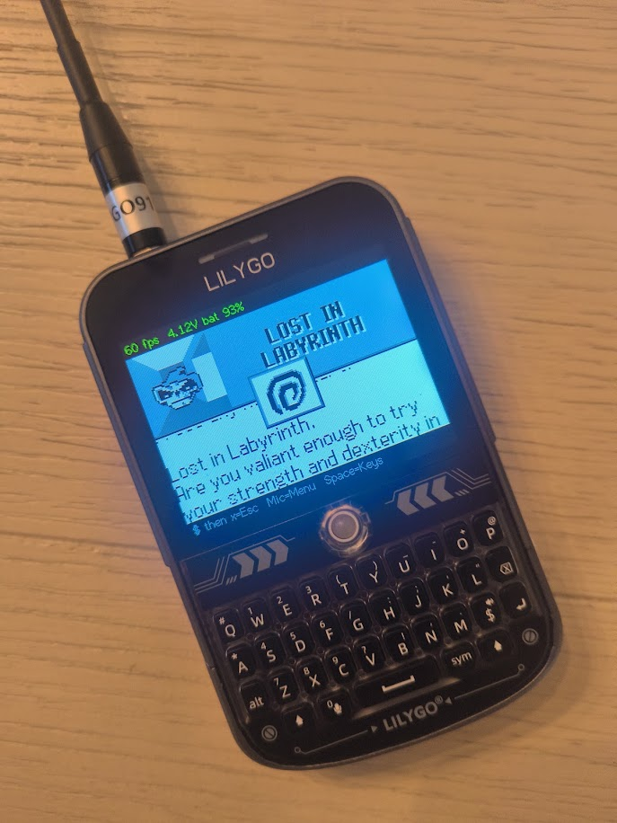
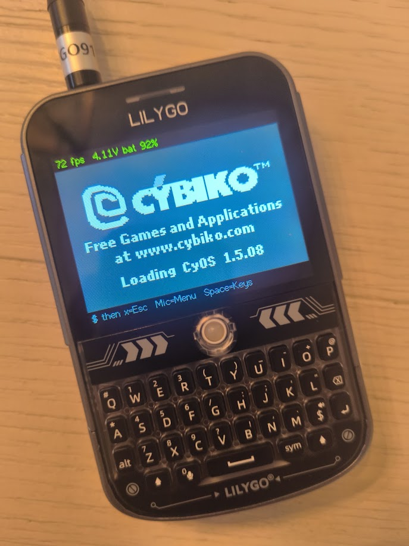
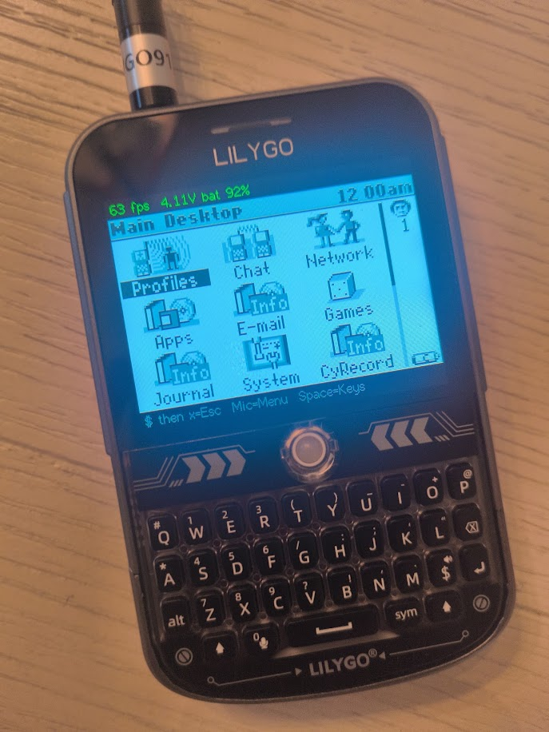
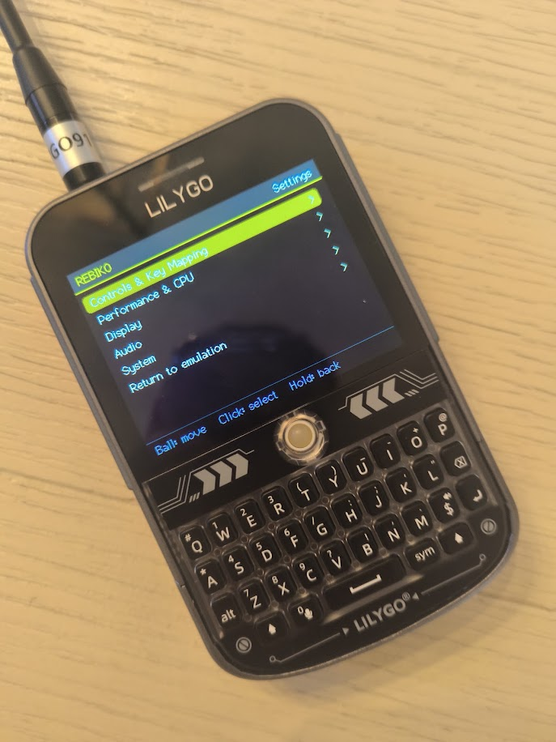
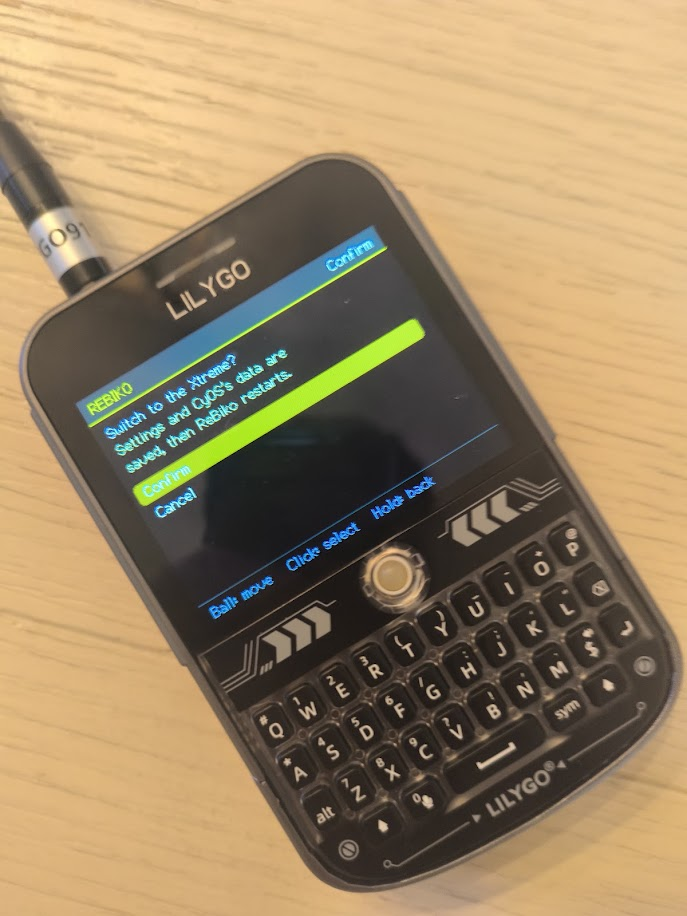

<h1 align="center">
  
</h1>

<p align="center"><em>Original CyOS. New hardware. Back on the air.</em></p>

<p align="center">
  <strong>v1.1027.1b (beta)</strong> · October 2026 ·
  <a href="https://github.com/RetroCodeRamen/rebiko/releases/tag/v1.1027.1b">Linux .deb &amp; zip</a>
</p>

<p align="center">
  
  &nbsp;
  
</p>

<p align="center"><sub>Classic · Xtreme</sub></p>

---

In 2001 you could buy a little blue handheld with a real OS, a tiny keyboard, and a radio that talked to the kid across the cafeteria. No account. No tower. Just CyOS and whoever was in range.

ReBiko does not recreate that vibe in a web app. **It boots the original CyOS.** Hitachi H8S, AT45 flash, the same keyboard matrix, the same chat — on a LilyGO T-Deck in your bag, or as a borderless Classic or Xtreme on your desktop with a Heltec as the radio dongle. LoRa is the transport under the old Cybiko radio, not a new protocol pretending to be one.

Three pieces:

- **ReBiko Desktop** — a Cybiko Classic or Xtreme on your PC (Linux and Windows)
- **ReBiko Pocket** — a LilyGO T-Deck that *is* a Cybiko, Classic or Xtreme
- **ReBiko Radio** — a Heltec V3 on USB, the radio for ReBiko Desktop

> Original guest. Modern hardware. Same cafeteria energy, slightly better RSSI.

**1.0 beta.** Testers welcome. The zip now includes Classic CyOS 1.2.46 so you can unzip and run. A git clone still does not — see [GETTING-ROMS.txt](GETTING-ROMS.txt). Xtreme dumps stay off the download.

---

## Get it

**[v1.1026.4b release](https://github.com/RetroCodeRamen/rebiko/releases/tag/v1.1026.4b)** — ReBiko Desktop, CyOS included, no compiler.

| File | What |
| --- | --- |
| `rebiko-desktop-v1.1026.4b-linux-x64.zip` | Linux (`libsdl2`, `libpng`, X11) |
| `rebiko-desktop-v1.1026.4b-windows-x64.zip` | Windows (SDL2 bundled) |

Unzip. `./run.sh` or `run.bat`. Classic boot ROM and CyOS 1.2.46 are already in `roms/`.

Plug in a **Heltec WiFi LoRa 32 V3**. The emulator finds the CP2102 on its own. Right-click the device for Settings — shell color, 4× LCD zoom, always-on-top, reboot/power, and flash buttons for the Heltec radio firmware and a LilyGO T-Deck (those still want [PlatformIO](https://platformio.org/) and this source tree). Full walkthrough below.

### From a git checkout

```bash
# Linux
cybiko-lilygo/tools/v1_emu.sh roms/cyrom112.bin roms/flash_v1246.bin

# ReBiko Pocket (T-Deck)
pio run -t upload --project-dir cybiko-lilygo -e T-Deck-Cybiko-V1

# ReBiko Radio (Heltec)
pio run -t upload --project-dir cybiko-heltec-modem
```

Omit `--radio` and the PC side attaches the first Heltec it sees.

---

## ReBiko Desktop

The PC emulator: a borderless photo of a Cybiko. Inside the LCD, unmodified CyOS is running — 1.2.46 or 1.2.57 on the Classic, 1.5.08 on the Xtreme. A Heltec V3 on USB is the radio. Settings → **Xtreme** (or **Classic**) switches shells, and the one you used last is the one that starts. The Xtreme's ROMs are not in the download.

<p align="center">
  
  &nbsp;
  
  &nbsp;
  
</p>

<p align="center"><sub>Classic — boot splash · Main Desktop · You &amp; Me</sub></p>

The Xtreme is the same window with the silver shell and CyOS 1.5.08.

<p align="center">
  
  &nbsp;
  
</p>

<p align="center"><sub>Xtreme — Loading CyOS 1.5.08 · Main Desktop</sub></p>

### Run it

From the release zip:

```bash
./run.sh          # Linux
run.bat           # Windows
```

From this tree (after you have the ROMs):

```bash
cybiko-lilygo/tools/v1_emu.sh roms/cyrom112.bin roms/flash_v1246.bin \
  --nvram roms/pc-classic.flash \
  --radio /dev/ttyUSB0 --cyid 4C000001
```

`--radio` is optional. If you skip it, the emulator picks the first Heltec CP2102 (`10c4:ea60`). `--nvram` keeps CyOS settings and files across launches.

First boot walks through the CyOS nickname wizard, then lands on the desktop.

### Using the device

| Input | Action |
| --- | --- |
| Type | Letters and numbers go to CyOS |
| Click a key on the photo | Same as pressing that key |
| Arrow keys | D-pad |
| Enter | Opens the highlighted item |
| Esc | Back |
| Drag the plastic | Moves the window |
| Right-click | Application menu |
| Ctrl+Q | Quit (saves NVRAM) |

The window is shaped to the device. Clicks on empty pixels pass through to whatever is behind it.

<p align="center">
  
</p>

<p align="center"><sub>CyOS 1.2.46 Main Desktop</sub></p>

### Right-click menu

<p align="center">
  
</p>

| Item | What it does |
| --- | --- |
| **Settings** | Shell, scale, radio flash, reboot/power |
| **Status** | Heltec, T-Deck USB, CyOS radio counters |
| **Help** | Keyboard map and a short getting-started note |
| **Minimize** | Hides the window |
| **Close** | Quits and writes the NVRAM image |

### Settings

Right-click the Classic → **Settings**.

<p align="center">
  
</p>

| Control | What it does |
| --- | --- |
| **Always on top** | Keeps the Classic above other windows |
| **Mute** | Silences the speaker |
| **Scale − / +** | 50–150%. The window stays proportional to the photo |
| **Shell** | Blue, Neon, or Purple translucent plastic |
| **Body** | The full device (default) |
| **4× zoom** | LCD only, pixel-doubled. Drag to move that window |
| **Reboot** | Cold-boots CyOS. Saved flash stays; RAM does not |
| **Power off / on** | Blanks the LCD and stops the guest; power-on boots again |
| **Xtreme / Classic** | Quits this shell and starts the other. Each model keeps its own save |
| **Flash Heltec** | Uploads ReBiko Radio to the detected CP2102 (needs PlatformIO) |
| **Flash T-Deck** | Uploads ReBiko Pocket to `/dev/ttyACM0` (needs PlatformIO) |

Preferences live in `~/.config/cybiko/v1_emu.conf` (Linux) or `%APPDATA%\cybiko\v1_emu.conf` (Windows).

### Shell colors

The photo is the original blue Classic. Neon and Purple recolor only the dyed plastic — keys, labels, and lighting stay. The Xtreme shell is the silver body above, and it is not recolored.

<p align="center">
  
</p>

<p align="center"><sub>Blue · Neon · Purple — pick one in Settings → Shell</sub></p>

### Status

Right-click → **Status**. This is the radio health panel, not a CyOS screen.

<p align="center">
  
</p>

| Block | Meaning |
| --- | --- |
| **Heltec** | USB modem found, ReBiko Radio linked, RSSI/SNR, packet counts |
| **T-Deck** | Whether a T-Deck CDC port is on USB |
| **CyOS radio** | Guest CyID, frames CyOS sent, frames delivered into CyOS |

---

## ReBiko Pocket

A LilyGO T-Deck that *is* the Cybiko: the original CyOS on its screen, its QWERTY keyboard as the Cybiko's, the trackball as the D-pad, and its LoRa radio as the Cybiko radio. One T-Deck carries both models. The green line on top is ReBiko's own: frame rate, battery voltage and charge.

<p align="center">
  
</p>

<p align="center"><sub>The Classic's Main Desktop, Chat highlighted</sub></p>

<p align="center">
  
  &nbsp;
  
  &nbsp;
  
</p>

<p align="center"><sub>Lost in Labyrinth on the Classic · the Xtreme loading CyOS 1.5.08 · the Xtreme's desktop</sub></p>

`$` then Mic opens the ReBiko menu: key remapping, CPU mode, display, audio, and **System → Machine**, which saves and restarts into the other model.

<p align="center">
  
  &nbsp;
  
</p>

<p align="center"><sub>The ReBiko menu · switching to the Xtreme</sub></p>

Flashing, the SD card layout and the keyboard are in [cybiko-lilygo/README.md](cybiko-lilygo/README.md).

---

## What you actually get

| Piece | Role |
| --- | --- |
| **ReBiko Desktop** | Borderless Classic or Xtreme shell. Classic CyOS 1.2.46 or 1.2.57, Xtreme CyOS 1.5.08. Heltec as the air interface |
| **ReBiko Pocket** | T-Deck handheld that *is* the Cybiko — keyboard, LCD, trackball, LoRa, battery |
| **ReBiko Radio** | Heltec V3 USB SLIP modem so the PC can share the same 915 MHz channel |

The guest is unmodified CyOS. This is not a Cybiko-style rewrite. Design notes live in [ARCHITECTURE.md](ARCHITECTURE.md). The work order, including what is done and what is open, is [PLAN.md](PLAN.md).

---

## Current status

Honest snapshot, 27 Oct 2026, release [v1.1027.1b](https://github.com/RetroCodeRamen/rebiko/releases/tag/v1.1027.1b).

### Working today

**On the air**
- CyOS Chat over LoRa between ReBiko Desktop (with a Heltec) and ReBiko Pocket (a T-Deck), both ways. Each Chat room is its own radio channel, as on the real Cybiko, so rooms stay apart.
- The radio follows the Classic's own co-processor firmware (`avr19c6.bin`, read out of Cybiko's update files): frames keep who they are addressed to, and the replies match the real chip.
- 915 MHz, SF7, 500 kHz, 22 dBm with listen-before-talk. A link readout on the T-Deck (menu > System) shows messages heard and lost, RSSI and SNR.

**The Cybiko itself**
- The original CyOS 1.2.46, and CyOS 1.2.57 (Cybiko's last Classic System Pack) via `tools/rebiko_cyos_update.py`. Full Cylandia runs under 1.2.57.
- Apps on and off a running Classic with nothing restarted: the Desktop's **Apps** window (your `Apps/` library beside the Cybiko's files), or `rebiko_apps.py` / `rebiko-apps` over USB or to the Desktop.
- A flash chip twice the real Classic's size (1 MB): about 560 KB free instead of 43 KB.
- A clock that keeps time (below).

**ReBiko Desktop**
- Linux (a `.deb` that installs into your launcher, or a zip) and Windows (v1.1026.4b).
- A photo-real Classic or Xtreme shell; switch between them in Settings. The Heltec is found by itself.

**ReBiko Pocket (T-Deck)**
- Classic and Xtreme on one T-Deck, switched from the menu.
- `$` Mic menu: remap any key, CPU mode, brightness, scale, volume, battery-saving backlight.
- Keyboard: Sym gives digits and symbols as printed on the keys, including the Classic's `! @ # % ^ & * ( ) _ + : " ? < > { } |`.
- Saves land on the SD card within seconds of CyOS writing them, without freezing (only the changed flash pages are written).
- 60 fps on the desktop and in most apps.

### Issues we hit, and how they are handled now

- **The clock.** A real Cybiko kept its clock running on battery even when "off". ReBiko starts CyOS fresh every time, and CyOS resets its clock to 12:00 AM, 1 January at every fresh start. ReBiko now puts the time back straight after. The T-Deck has no battery-backed clock either, so it keeps the time across restarts, and after a power-off resumes from the last time it saved (it saves every 5 minutes and whenever the time is set). It gets the right time when you set it in CyOS's Settings, or from ReBiko Desktop, which sends its clock over LoRa every 30 s to any T-Deck in range. Chasing this found an emulator CPU bug (`MULXU.B` multiplied the wrong byte) that had been garbling every BCD number in CyOS and its apps; it is fixed.
- **Stale patches on the T-Deck screen.** Large screen updates sometimes didn't fully reach the panel (white bars on the boot logo, half an old screen). Panel transfers are now finished before the panel is released, and a slow background refresh repaints the whole screen every few seconds, so anything missed heals by itself. The root cause of the occasional lost transfer is not known yet.
- **Cylandia runs at 54–58 fps on the T-Deck.** That is the emulator, not the drawing: CyOS alone needs 90–97% of the T-Deck's time in Cylandia. A faster core is on the list.
- **USB input on the T-Deck can stop** if a PC tool opens and closes the port repeatedly while it is booting. It keeps running; a reset or replug brings USB input back.
- **The Windows download is still v1.1026.4b**, which uses the older radio link and won't talk to v1.1027.1b units.

### Up next

1. Private messages and the people list over the air, then multiplayer games.
2. Classic ↔ Xtreme chat.
3. A Windows build of v1.1027.1b.
4. Two T-Decks in the same room (needs a second T-Deck).
5. A faster emulator core for heavy apps like Cylandia.
6. Time from WiFi for T-Decks away from the Desktop; radio settings in the Pocket menu; longer range (SF8/SF9).
7. Apps on the Xtreme; the Xtreme battery reading.

One thing we checked and ruled out: the Cybiko never relayed messages from one unit to another. Neither the shipped CyOS nor its radio co-processor forwards anything (`tools/v1_three.sh` with `CHAIN=1` shows it), so reaching past radio range will come from ReBiko itself, through the planned internet relay.

---

## Card layout (ReBiko Pocket)

| Path | Role |
| --- | --- |
| `/cybiko/boot.bin` | XT boot ROM (`cyrom150.bin`, 32 KB) |
| `/cybiko/flash.bin` | CyOS 1.5.08 (`cyos_v1508.bin`, 512 KB) |
| `/cybiko/save.nvram` | Guest RAM image, written back every few minutes |
| `/cybiko/apps/*.app` | Injected into that save before boot if the name is new |
| `/cybiko-v1/boot.bin` | Classic boot ROM (`cyrom112.bin`) |
| `/cybiko-v1/flash.bin` | CyOS 1.2.46 (`flash_v1246.bin`) |
| `/cybiko-v1/save.flash` | Flash chip image (1 MB), written 10 s after CyOS's last change |

Classic dumps ride along in the zip. They stay out of git. XT dumps and `.app` files stay off both.

---

## What's in the tree

| Path | Role |
| --- | --- |
| `cybiko-c-emulator` | H8S core, host tests, radio codec, `two_boot` |
| `cybiko-lilygo` | ReBiko Pocket firmware (XT default, Classic env) and ReBiko Desktop (`tools/v1_emu.c`) |
| `cybiko-heltec-modem` | ReBiko Radio, the Heltec V3 USB LoRa modem |
| `img/pc/` | Screenshots of ReBiko Desktop |

```bash
make -C cybiko-c-emulator test
```

Dan Berkowitz's Java emulator is a local reference for radio and SCI behavior. It is not in this repo.
